<div align="center">



<br />

<a href="https://jon-zhang-portfolio-2026.perkyaisle4.chatgpt.site/"></a>
<a href="https://www.linkedin.com/in/jonxsong/"></a>
<a href="https://github.com/jonxsong?tab=repositories"></a>
<a href="https://www.overleaf.com/project/6af3be5dcb8d4f7336950eb2/share#bde3fd1173b1b1ea75c85a1736f15deed095f0cfd7c466db"></a>

<br /><br />


</div>

<br />

## `01 / ABOUT`

I build at the intersection of **models, data, scalable software, and product**. My work spans multi-agent research systems, enterprise knowledge retrieval, asynchronous AI workflows, data platforms, and full-stack experiences that make complex technology feel natural.

```typescript
const jon = {
  now: "GenAI Engineer @ Amdocs",
  craft: ["agentic systems", "full-stack products", "data platforms"],
  approach: "start with evidence, understand the system, make it useful",
  education: ["M.S. Data Science — Northwestern", "B.S. Data Science — UC San Diego"],
  currently: "turning ambitious ideas into real-world products",
};
```

> ✦ I care about systems that are rigorous under the hood and inevitable in the hand.

<br />

## `02 / CAPABILITIES`

<sub>AI / AGENT SYSTEMS</sub><br />


<sub>LANGUAGES / CORE</sub><br />


<sub>PRODUCT / APIS</sub><br />


<sub>DATA / RETRIEVAL</sub><br />


<sub>CLOUD / DELIVERY</sub><br />


<sub>ML / ANALYTICS</sub><br />


<sub>ENTERPRISE INTEGRATIONS</sub><br />


<br />

## `03 / SELECTED WORK`

<table>
  <tr>
    <td width="33%" valign="top">
      <sub>01 · AI / MARKET INTELLIGENCE</sub>
      <h3>Omnigaze</h3>
      <p>A personalized intelligence workspace that turns fragmented market signals into clear, evidence-backed decisions.</p>
      <p><code>GenAI</code> <code>Full-stack</code> <code>Product design</code></p>
      <a href="https://omnigaze.perkyaisle4.chatgpt.site/">Live ↗</a> · <a href="https://github.com/jonxsong/Omnigaze">Source ↗</a>
    </td>
    <td width="33%" valign="top">
      <sub>02 · AI / WEATHER EXPERIENCE</sub>
      <h3>Afterglow</h3>
      <p>AI-assisted sunset forecasting with live weather, solar geometry, predicted palettes, vibrancy scores, and viewing windows.</p>
      <p><code>OpenAI</code> <code>Open-Meteo</code> <code>Bilingual</code></p>
      <a href="https://afterglow-sky-forecast.perkyaisle4.chatgpt.site/">Live ↗</a> · <a href="https://github.com/jonxsong/afterglow">Source ↗</a>
    </td>
    <td width="33%" valign="top">
      <sub>03 · AI / SPORTS INTELLIGENCE</sub>
      <h3>CourtVision</h3>
      <p>An NBA intelligence platform with real stats, live games, interactive comparisons, shot charts, and an AI research assistant.</p>
      <p><code>OpenAI</code> <code>Live NBA data</code> <code>Full-stack</code></p>
      <a href="https://courtvision-analytics.perkyaisle4.chatgpt.site/">Live ↗</a> · <a href="https://github.com/jonxsong/CourtVision">Source ↗</a>
    </td>
  </tr>
</table>

<br />

## `04 / EXPERIENCE`

| Chapter | Role | Focus |
| :--- | :--- | :--- |
| **2026 — now** | **GenAI Engineer · Amdocs** | Production-ready AI applications at the intersection of models, data, and scalable software. |
| **2023 — 2026** | **AI Software Engineer / Data Engineer · EIS Group** | Multi-agent investigation, enterprise RAG, async AI workflows, retrieval systems, and governed analytics. |
| **2021 — 2022** | **Data Scientist · Pandio** | Machine-learning deployment and product / operational analytics. |
| **2021 — 2023** | **M.S. Data Science · Northwestern** | Data engineering; price optimization and demand forecasting. |
| **2016 — 2021** | **B.S. Data Science · UC San Diego** | The analytical foundation: evidence first, systems thinking, useful outcomes. |

<br />

## `05 / LIVE SIGNAL`

<div align="center">


<br />


</div>

<br />

---

<div align="center">

### Have a thoughtful problem worth building around?

**[Explore the portfolio ↗](https://jon-zhang-portfolio-2026.perkyaisle4.chatgpt.site/)** &nbsp;·&nbsp; **[Connect on LinkedIn ↗](https://www.linkedin.com/in/jonxsong/)**

<sub>JON ZHANG © 2026 · GENAI × ENGINEERING × PRODUCT</sub>

</div>
