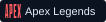

 

  

 

## `01 / ABOUT ME`

I work across AI, data, backend systems, and product development—taking ideas from mock-ups to production-ready software. I enjoy the challenge of turning complex problems into reliable, useful products, particularly chasing the feeling of owning something I’ve shipped end to end.

Outside of engineering, basketball is a big part of my life. I love playing in organized leagues, following the <picture></picture>, and watching <picture></picture> every year. When I’m not on the court, I enjoy snowboarding and listening to jazz—I’m a big jazz guy (). I’m also an avid gamer, always chasing that competitive thrill, whether it’s through shooters like <picture></picture> and <picture></picture>, or strategy games like <picture></picture>.

 

## `02 / TECH STACK`

LANGUAGES 
<picture></picture>
<picture></picture>
<picture></picture>
<picture></picture>
<picture></picture>

AI / AGENTS 
<picture></picture>
<picture></picture>
<picture></picture>
<picture></picture>
<picture></picture>

FRONTEND / APPS 
<picture></picture>
<picture></picture>
<picture></picture>
<picture></picture>
<picture></picture>

BACKEND / APIS 
<picture></picture>
<picture></picture>
<picture></picture>
<picture></picture>

DATA / RETRIEVAL 
<picture></picture>
<picture></picture>
<picture></picture>
<picture></picture>
<picture></picture>

ORCHESTRATION / AUTOMATION 
<picture></picture>
<picture></picture>
<picture></picture>
<picture></picture>

CLOUD / INFRASTRUCTURE 
<picture></picture>
<picture></picture>
<picture></picture>
<picture></picture>

QUALITY / EVALUATION / OBSERVABILITY 
<picture></picture>
<picture></picture>
<picture></picture>
<picture></picture>

 

## `03 / PROJECTS`

<table>
  <tr>
    <td width="50%" valign="top">
      
        
      
A personalized intelligence workspace that turns fragmented market signals into clear, evidence-backed decisions.

      
<code>GenAI</code> <code>Full-stack</code> <code>Product design</code>

      <a href="https://omnigaze.jonzhang.dev/">Live ↗</a> · <a href="https://github.com/jonxsong/Omnigaze">Source ↗</a>
    </td>
    <td width="50%" valign="top">
      
        
      
AI-assisted sunset forecasting with live weather, solar geometry, predicted palettes, vibrancy scores, and viewing windows.

      
<code>OpenAI</code> <code>Open-Meteo</code> <code>Bilingual</code>

      <a href="https://afterglow-sky-forecast.perkyaisle4.chatgpt.site/">Live ↗</a> · <a href="https://github.com/jonxsong/afterglow">Source ↗</a>
    </td>
  </tr>
  <tr>
    <td width="50%" valign="top">
      
        
      
An NBA intelligence platform with real stats, live games, interactive comparisons, shot charts, and an AI research assistant.

      
<code>OpenAI</code> <code>Live NBA data</code> <code>Full-stack</code>

      <a href="https://courtvision.jonzhang.dev/">Live ↗</a> · <a href="https://github.com/jonxsong/CourtVision">Source ↗</a>
    </td>
    <td width="50%" valign="top">
      
        
      
An iPhone-first, offline-first personal operating system connecting goals, tasks, habits, milestones, and private reflections.

      
<code>Expo</code> <code>React Native</code> <code>SQLite</code> <code>Go</code>

      <a href="https://orbit.jonzhang.dev/">Live ↗</a> · <a href="https://github.com/jonxsong/orbit">Source ↗</a>
    </td>
  </tr>
</table>

 

## `04 / EXPERIENCE`

| Chapter | Role | Focus |
| :--- | :--- | :--- |
| **2026 — now** | **GenAI Engineer · Amdocs** | Production-ready AI applications at the intersection of models, data, and scalable software. |
| **2023 — 2026** | **AI Software Engineer / Data Engineer · EIS Group** | Multi-agent investigation, enterprise RAG, async AI workflows, retrieval systems, and governed analytics. |
| **2021 — 2022** | **Data Scientist · Pandio** | Machine-learning deployment and product / operational analytics. |
| **2021 — 2023** | **M.S. Data Science · Northwestern University** | Data engineering; price optimization and demand forecasting. |
| **2016 — 2020** | **B.S. Data Science · UC San Diego** | The analytical foundation: evidence first, systems thinking, useful outcomes. |

 

## `05 / LIVE SIGNAL`

 

 

---

**[Explore the portfolio ↗](https://jon-zhang-portfolio-2026.perkyaisle4.chatgpt.site/)** &nbsp;·&nbsp; **[Connect on LinkedIn ↗](https://www.linkedin.com/in/jonxsong/)**

JON ZHANG © 2026 · GENAI × ENGINEERING × PRODUCT

